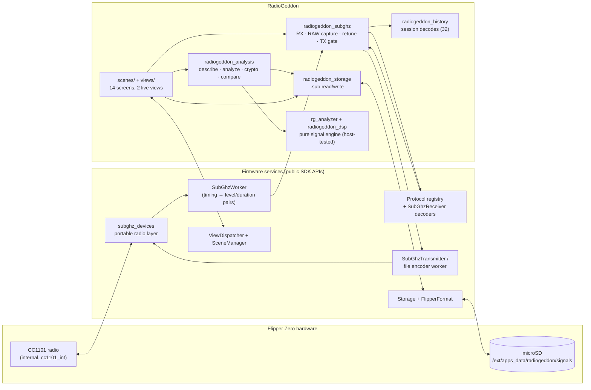
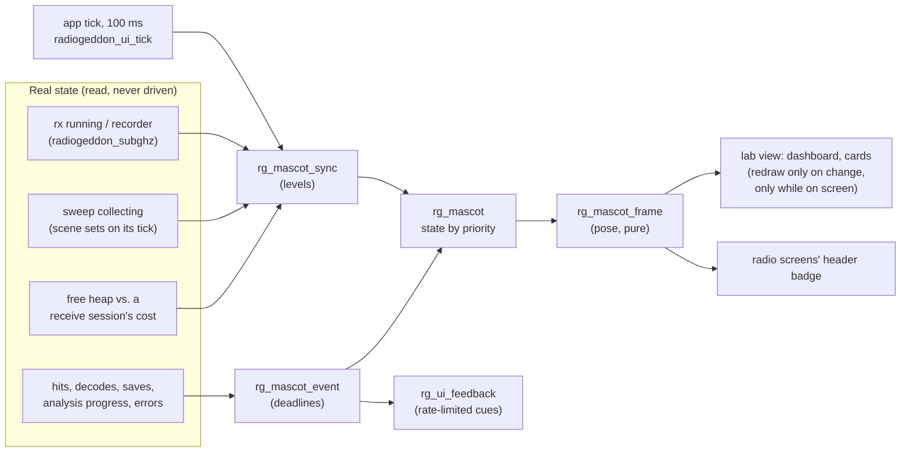
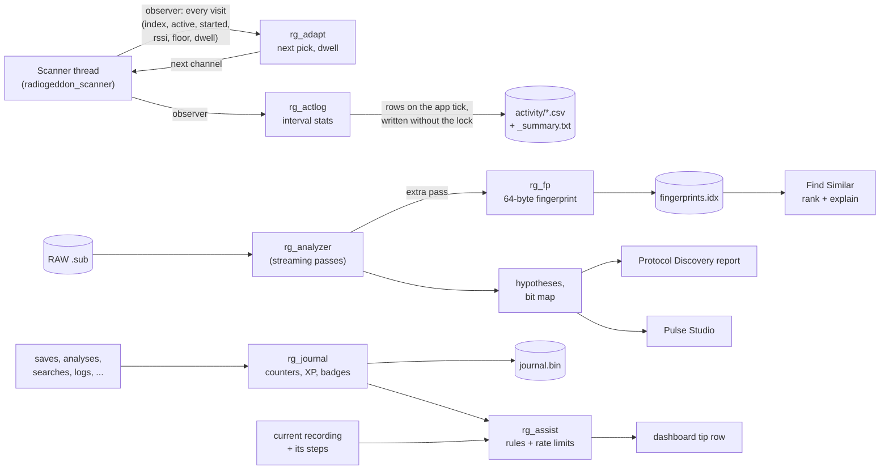
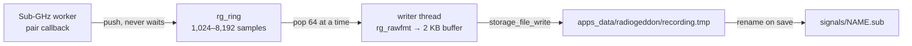

# Architecture

RadioGeddon is a single Flipper Zero external application (`.fap`) written in
C. Everything — reception, decoding, storage and analysis — runs on the
device's STM32WB55 and CC1101 radio; nothing is sent to a phone or computer.

This page explains how the pieces fit together. For what each screen does, see
the [User Guide](USER_GUIDE.md); for the analysis logic, see
[Protocol Analysis](PROTOCOL_ANALYSIS.md).

## Overview



## Source layout

```
radiogeddon.c / .h          App context: allocates services, views and scenes; 100 ms UI tick
                            (which also drives Dolphin Lab, radiogeddon_ui_tick) 
radiogeddon_version.h       Release version string (checked against the release tag)
application.fam             Flipper app manifest (appid, category, icon, sources)
scenes/                     One file per screen; the scene list is generated from
                            radiogeddon_scene_config.h (X-macros)
views/                      Custom canvas views: scanner sweep, live receiver, pulse timeline,
                            database list, waterfall [Full], bitstream explorer [Full],
                            Dolphin Lab dashboard and cards, mascot drawing, lab room [Full]
modules/                    Full-only plugins (.fal) built from the sources below, and their
                            manifest (modules.fam): waterfall, bits, multi, unknown, sessions, lab,
                            fp, studio, log, reports
art/dolphin/                The mascot, props and icons as editable text art (Dolphin Lab)
helpers/
  radiogeddon_subghz.*      Radio wrapper: device, decoders, RAW capture, hopper retune, TX
  radiogeddon_bands.*       Modulation presets and frequency lists (no radio SDK needed)
  radiogeddon_recorder.*    Streaming RAW recorder: lock-free ring + SD writer thread
  radiogeddon_storage.*     SD-card layout, .sub parsing, streaming RAW file access
  radiogeddon_scanner.*     Scanner sweep thread, results and CSV export
  radiogeddon_hopper.*      Hopper thread, auto-recording, statistics report
  radiogeddon_settings.*    Settings persisted to the SD card
  radiogeddon_db.*          Database index: lists the signals folder, reads file heads
  radiogeddon_report.*      Writes a file's analysis reports to reports/<name>.txt
  radiogeddon_memdiag.*     Heap sampling and the About memory figures
  radiogeddon_history.*     Per-session list of decoded signals (max 32, de-duplicated)
  radiogeddon_decode_text.* A decode's description (data-only for decoders needing a table)
  radiogeddon_analysis.*    Text reports: info, analysis, crypto, compare, unknown-protocol,
                            firmware decode
  radiogeddon_dsp.*         Pure RAW parsing / clustering helpers (no firmware headers)
  rg_analyzer.*             Pure streaming signal-analysis engine (no firmware headers)
  rg_raw.*                  Pure streaming RAW_Data reader with seek checkpoints
  rg_decode.*               Pure RAW-to-decoder feeder and list of distinct decodes
  rg_rawfmt.*               Pure RAW .sub writer: header, RAW_Data lines, lost-sample note
  rg_ring.*                 Pure lock-free single-producer/single-consumer sample ring
  rg_timeline.*             Pure pulse-timeline maths: columns, labels, pan, zoom, frames
  rg_scan.*                 Pure scanner logic: noise floor, detection, peak hold
  rg_hop.*                  Pure hopper state machine: dwell, hold, lock, history
  rg_db.*                   Pure database index: .sub header parsing, duplicates, query
  rg_memstat.*              Pure memory bookkeeping: lowest/peak, session cost, fit check
  rg_freq.*                 Pure frequency text (433.92 / 433.075) and range checks
  rg_preset.*               Pure check of a file's custom CC1101 preset before Replay loads it
  rg_txpolicy.*             Pure transmit check from the firmware's region facts (per edition)
  rg_range.*                Pure band probing and range plans (start/end/step, gaps skipped) [Full]
  rg_spectrum.*             Pure range-scan display maths: compact points, median floor, columns [Full]
  rg_checksum.*             Pure checksum / CRC-8 / parity structure hypotheses [Full]
  radiogeddon_rangescan.*   Range Scanner engine: sweep thread, per-point rg_scan, CSV [Full]
  radiogeddon_profiles.*    Favorites and scan profiles on the SD card [Full]
  rg_waterfall.*            Pure RSSI sweep history: ring of rows, columns, levels, dither [Full]
  rg_bits.*, rg_glyph.*     Pure bit/byte/diff/field extraction and a 3x5 glyph font [Full]
  rg_multi.*                Pure multi-capture summaries, comparison and report [Full]
  rg_session.*              Pure research-session file format, save steps, grouping [Full]
  rg_elf.*                  Pure size of an ELF file's allocated sections (module check) [Full]
  radiogeddon_multi.*       Multi-Capture Compare over files, one at a time [Full, module]
  radiogeddon_sessions.*    Research sessions on the SD card, active session [Full]
  radiogeddon_module.c      Module loader: memory check, load, unload, error text [Full]
  radiogeddon_modules.h     The structs each module returns, and their file names [Full]
  radiogeddon_host*.h       The app helpers handed to the Sessions module [Full]
  rg_mascot.*               Pure mascot state machine: events, levels, priorities, poses [Full]
  rg_ui.*                   Pure UI logic: styles, feedback limiter, transitions, dither, wrap,
                            menu window, oscilloscope trace, firmware family [Full]
  rg_sprites.*              Generated sprite bitmaps (tools/dolphin/build_sprites.py) [Full]
  radiogeddon_ui.*          Dolphin Lab bridge: events in, level sync on the tick, cards,
                            reveal, dashboard status, feedback cues [Full]
  rg_fp.*                   Pure signal fingerprint: builder pass, compare, rank, index records [Full]
  rg_crc.*                  Pure CRC-32 (fingerprint index, journal)
  rg_adapt.*                Pure adaptive scan scheduling: stride, fairness, dwell [Full]
  rg_actlog.*               Pure activity log: per-interval stats, rows, rotation, summary [Full]
  rg_journal.*              Pure research journal: counters, XP, achievements, file format [Full]
  rg_assist.*               Pure assistant rules and rate limits [Full]
  rg_studio.*               Pure Pulse Studio maths: bit map, window, histogram, diff [Full]
  radiogeddon_fp.*          Fingerprint index on the SD card, Find Similar [Full, module]
  radiogeddon_actlog.*      Activity log files: parts, footer, summary [Full, module]
  radiogeddon_research.*    Journal persistence, current recording, steps, tips [Full]
  radiogeddon_analysis_decode.c  Firmware decode report (resident; the other reports are a module)
  radiogeddon_analysis_status.c  Progress hook and status texts of the analyses (resident)
  rg_safefile.*, radiogeddon_safefile.*  Crash-safe replacement of app files (commit marker)
  rg_recover.*, radiogeddon_recovery.*   Recording recovery: check, repair, offer [Full: module]
  rg_heatmap.*, radiogeddon_heatmap.*    RF Activity Heatmap from logger files [Full, module]
  radiogeddon_memdiag_text.c  The memory and diagnostics text (About, saved report) [Full: module]
radiogeddon_edition.h       The edition (Full / Catalog) and its RG_FEATURE_* switches
catalog/                    Apps Catalog description, changelog, manifest template, screenshots
assets/                     10x10 launcher icon (compiled into the .fap)
test/                       Host unit tests (2,528 checks), format, decoder, capture, lifecycle,
                            file (fpindex, actlogfiles) and offline UI tests (test/ui: host canvas,
                            firmware fonts), fuzz, fixtures
scripts/                    Edition staging, pinned builds, manifest and import verification, packaging,
                            catalog checks, link check
tools/brand/                Generator for the logo, banner and social preview
tools/dolphin/              Sprite generator: art/dolphin/*.txt -> helpers/rg_sprites.c
.github/workflows/          CI (ci.yml), shared build pipeline (build.yml), release.yml
```

## Editions

`radiogeddon_edition.h` turns `RADIOGEDDON_EDITION_FULL` or
`RADIOGEDDON_EDITION_CATALOG` (from the manifest's `cdefines`) into
`RG_FEATURE_*` switches: `RG_FEATURE_RANGE_SCAN`, `_FAVORITES`, `_FREQ_STEP`,
`_BAND_INFO`, `_CHECKSUM_HINTS`, `_WATERFALL`, `_BITSTREAM`, `_MULTI_COMPARE`,
`_SESSIONS` (Full) and `_REGION_TX_GATE` (Catalog). Code
asks for a feature, never for an edition. With neither defined the build is a
Catalog build.

`application.fam` is the Catalog edition, so a plain `ufbt` — the way the Apps
Catalog builds — produces it. `scripts/stage_edition.py full DEST` copies the
tracked files and rewrites four manifest fields (appid `radiogeddon_full`,
name, description, the define), each of which must match exactly once.
Full-only scenes are registered only in Full builds (the scene list's X-macro
has a `#if`), and Full-only modules compile to nothing in the Catalog edition,
so it carries none of their code (77,173 B resident against the Full edition's
104,388 B). Settings, storage and the radio layer are the same code in both, so
either edition reads, writes and keeps the other's files in
`/ext/apps_data/radiogeddon`.

### Modules (Full edition)

A `.fap` is loaded whole into the heap and stays there while the app runs.
The Full edition's larger optional tools are therefore built as plugins
(`apptype=FlipperAppType.PLUGIN`, `fal_embedded=True` in
`modules/modules.fam`, appended to the manifest by `stage_edition.py full`):
the firmware unpacks them into the app's assets folder, and
`radiogeddon_module_load()` opens one with the firmware's plugin manager
(application id `radiogeddon_full`, `RADIOGEDDON_MODULE_API`) when its screen
opens; the scene unloads it in `on_exit`. A module links against the
firmware's API only: its entry point returns a struct of functions
(`radiogeddon_modules.h`), and everything from the app it needs is passed in.
The Sessions module's scenes call a few app helpers (messages, progress,
loading another module) through a table the app hands it
(`radiogeddon_host.h`; in a module build `radiogeddon_host_map.h` maps the
helpers' names onto it, so the scene sources compile unchanged in both).

Before loading, `rg_elf` reads the `.fal`'s section table and models what
the firmware's loader will allocate for it (beta 11): every loaded section
in an aligned block of its own with its bookkeeping and the debug link
(kept while loaded), and the `.fast.rel.*` relocation tables (loaded with
the sections, freed once relocated, so gone before the tool's work starts).
The free block asked for is that, plus 2 KB for the loader's own records,
plus the larger of the relocation tables and the tool's work (they never
coexist), plus a 4 KB margin; if that does not fit, the screen says `Not
enough memory` before anything is allocated (Flipper's `malloc` never
returns NULL, so the check must come first). Beta 10 added a flat 6 KB for
the loader instead, which over-reserved for small modules and was less than
the Range Scanner module's relocation tables and file object.
`scripts/module_cost.py` prints the figures for the built modules and, in
CI, checks the C model against its own reading of them;
`test/bench_modules.c` replays each module's real load sequence on
fragmented heaps through the heap model (see "Memory lifetimes" below). `RADIOGEDDON_MODULE_API` changes with any module struct, so
a stale `.fal` is refused, not called. Sources used only by modules are
listed in `stage_edition.py`'s `FULL_MODULE_ONLY` and left out of the app
itself; small shared helpers (`rg_analyzer`, `rg_raw`, `rg_freq`, …) are
compiled into each module that needs them as well.

| Module | Contents | Beta 8 | Beta 9 | Beta 10 | Beta 11 |
|--------|----------|-------:|-------:|-------:|-------:|
| `radiogeddon_wf.fal` | Waterfall view (with the Dolphin Lab badge and entry reveal) | 4,312 B | 4,496 B | 4,497 B | 4,497 B |
| `radiogeddon_bits.fal` | Bitstream Explorer; since beta 10 its scene and the analyzer it runs | 6,488 B | 6,720 B | 16,593 B | 16,170 B |
| `radiogeddon_unknown.fal` | Smart Protocol Discovery report, hypotheses, checksum hypotheses | 15,608 B | 18,612 B | 18,784 B | 18,368 B |
| `radiogeddon_multi.fal` | `rg_multi`, comparison over files | 15,960 B | 16,987 B | 17,159 B | 16,747 B |
| `radiogeddon_sessions.fal` | Sessions scenes, `rg_session`, the Database list code they use | 16,380 B | 16,422 B | 16,871 B | 16,627 B |
| `radiogeddon_lab.fal` | Room 2.0, Research Journal, Assistant and customization scenes | 8,835 B | 18,297 B | 18,508 B | 17,914 B |
| `radiogeddon_fp.fal` | Find Similar scene, `rg_fp`, index update; since beta 10 the session reader for its session scope | — | 20,370 B | 23,620 B | 23,608 B |
| `radiogeddon_studio.fal` | Pulse Studio and Pulse Timeline scenes and views, `rg_studio`, `rg_timeline` | — | 21,904 B | 22,108 B | 21,711 B |
| `radiogeddon_log.fal` | Activity Logger and Adaptive setup scenes, log files | — | 9,158 B | 9,176 B | 8,577 B |
| `radiogeddon_reports.fal` | Analysis, crypto, comparison and report scenes, report writer | — | 18,198 B | 18,384 B | 17,951 B |
| `radiogeddon_range.fal` | Range Scanner setup and scan, Waterfall scene, scan profiles, the range engine and spectrum view | — | — | 21,740 B | 21,128 B |
| `radiogeddon_settings.fal` | Settings and Radio bands scenes | — | — | 7,296 B | 6,452 B |
| `radiogeddon_hopper.fal` | Frequency Hopper and its statistics, the hopper engine | — | — | 7,264 B | 7,316 B |
| `radiogeddon_heatmap.fal` | RF Activity Heatmap scene and view, `rg_heatmap` | — | — | 5,955 B | 5,365 B |
| `radiogeddon_about.fal` | About, the memory and diagnostics text, the saved report | — | — | 4,168 B | 3,561 B |
| `radiogeddon_recover.fal` | Recording recovery at startup (`rg_recover`), only when a capture was cut off | — | — | 3,554 B | 3,003 B |

Sizes are the bytes the loader places in RAM (`scripts/fap_size.py`),
from the Momentum builds (Unleashed and RogueMaster within a few bytes).
Beta 11's modules are smaller mostly because none of them links the
compiler's 64-bit division helper any more (`rg_div`, below).

**Tool forwarders (beta 9).** The newer module screens are ordinary scenes
whose handlers live in a module. `scenes/radiogeddon_scene_tools.c` (resident)
lists each such scene with its module and the index of its handlers in the
module's `RadioGeddonToolModule` table, and provides tiny forwarding
`on_enter/on_event/on_exit` functions. A scene's module is loaded into one of
two slots on entry (two, because a module screen can open another module's
screen, e.g. Find Similar → Compare); `radiogeddon_scene_tools_tick` unloads a
slot once none of its scenes is on the scene stack — never inside `on_exit`,
because the module's code may still be on the call stack there. Module
scenes reach the app through the host table (`radiogeddon_host.h`), which
in beta 9 also carries the research hooks (journal record, current
recording, steps) and the session helpers.

**Beta 9 memory.** The resident Full edition is 119,132 B (beta 8:
119,428 B) although it holds the new tools' entry points, the research hub,
the adaptive scheduler and the scanner observer: the new screens, the
analysis/crypto/comparison reports and the Pulse Timeline are modules, the
Unknown Protocol report's hypotheses are computed on request, and settings
are read and written from one table instead of one call per field. The
Catalog edition is 80,553 B (beta 8: 77,782 B), the growth being the
analyzer's bit map and PWM fixes. The largest module is Pulse Studio
(21,904 B); with its screen model (about 4 KB) and a frame buffer it
checks the free heap before opening.

**Beta 10 memory.** Beta 9's resident Full edition (119,132 B) did not fit
the free heap of some devices, so the app did not start. Beta 10 moves the
Range Scanner (with the Waterfall scene and scan profiles), Settings (with
Radio bands), the Frequency Hopper (with its statistics), the whole
Bitstream Explorer (scene, screen and the analyzer), About (with the
diagnostics text) and recording recovery into modules, without changing
what any screen does: the resident Full edition is 84,313 B (Momentum;
−34,819 B, −29 %) although it gained crash-safe saves, the diagnostics
counters, the battery saver and the new tools' entry points. The Hopper's
state outlives its screen (until the main menu), so the app keeps its own
copy of `radiogeddon_hopper_free()` (the linker keeps only that and the stop
it calls); the Range Scanner's and Hopper's engines reach the radio through
the host table (`RADIOGEDDON_MODULE_API` 5). The Catalog edition, which has
no modules, is 86,513 B (beta 9: 80,553 B, +5,960 B): recovery (+2.4 KB),
the diagnostics and battery saver (+2.1 KB), crash-safe saves (+0.6 KB) and
the faster Database engine (+0.6 KB) are resident there.

The Bitstream Explorer keeps the analyzer it ran for as long as it is open
and points at the analyzer's result (its first member) instead of copying
the result out: 8,672 B held, where beta 9 held a 4,072 B copy but needed
both, 12,744 B, at once, and left a hole where the analyzer had been.

**Beta 11 memory: lifetimes, not just code.** Beta 11 keeps the binary
footprint where beta 10 left it (resident Full 84,433 B, Catalog 86,565 B;
beta 10: 84,313 / 86,513 B) and works on the heap the app uses while it
runs. See "Memory lifetimes" below and [Performance](PERFORMANCE.md).

*Binary footprint is not runtime RAM.* The figures above are code and
static data, from the built files (`scripts/fap_size.py`); the loader puts
exactly that in the heap. At run time the heap also holds the app state
(`RadioGeddonApp` 2,240 B Full, 616 B Catalog), the GUI views, the 4 KB app
stack, the radio session while a radio screen is open (the About screen
shows its measured cost), the open tool's module and its work: for example
the Bitstream Explorer adds its module (16,170 B) and keeps the analysis
result (4,072 B; beta 10 kept the 8,672 B analyzer), Find Similar its
module (23,608 B) and one analysis while fingerprinting. Every tool checks the free heap for its module and work
before allocating anything. None of the runtime figures has been measured on
a device yet; `scripts/struct_sizes.py` gives the heap objects' sizes as the
device compiler lays them out.

Built into the app (as measured just before the move), the tools made the
resident Full edition 128,309 B, 33,633 B more than beta 6; as modules it is
104,388 B, 9,712 B more (the screens' entry points, the Waterfall history in
the Range Scanner engine, the active session's hook on saving, the loader,
and analyzer work shared with the Catalog edition). The Unknown Protocol
Analysis report, resident in beta 6, now loads only while it runs.

## Dolphin Lab (Full edition)



- **State machine** (`rg_mascot`, pure, host-tested and fuzzed). Activities
  that last (scanning, receiving, recording, analysing, low memory) are
  levels; reactions (a detection, a save, an error) are deadlines, so a burst
  of events moves one deadline and never queues. The state is the most
  important that applies: Error > Low memory > Recording > Receiving >
  Signal detected > Scanning > Analyzing > Saved > Asleep > Bored > Idle.
  `rg_mascot_pose(state, t)` turns a state and the time since it began into
  a pose (eyes, flipper, flukes, headphones, antenna, prop, effect) with
  one-byte fields, so two frames compare with `memcmp`.
- **Real events only.** The tick reads `radiogeddon_subghz_is_rx_running`,
  `radiogeddon_subghz_is_recording` and the heap; scenes report hits,
  decodes, saves, refusals and analysis progress. The UI never calls into the
  radio, and the REC indicator follows the recorder's own pointer, so it
  cannot show a recording that failed or stopped.
- **Drawing.** `views/radiogeddon_mascot_draw.c` composes the dolphin from the
  generated sprites (`canvas_draw_xbm` with transparency, so overlays never
  erase) and draws props with canvas primitives; nothing is allocated and
  there is no frame buffer of its own. The art is text in `art/dolphin/`;
  `tools/dolphin/build_sprites.py` regenerates `helpers/rg_sprites.c` (373
  bytes) and `make -C test check` fails if it is stale.
- **Timing and power.** No timer is added: the app's existing 100 ms tick
  advances the lab view, which redraws only when the frame changed and only
  while it is on screen (its enter/exit callbacks). Idle animation changes
  about twice a second; active states up to 8 times. Transitions
  (`rg_transition`) are levels computed from the tick's time, so a key ends
  one at once and is handled as usual.
- **Memory.** The lab view (a View and a ~400-byte model) exists only while
  the style is not Classic, which is also what runs when less than 8 KB is
  free at start. The room is a module (`radiogeddon_lab.fal`) loaded only
  while it is open and refused, as any module, when it would not fit; it is
  unloaded before any tool it opens starts. Cards replace popups without new
  allocations. Resident cost when it came (beta 8): Full 119,428 B (beta 7:
  104,388 B); the Catalog edition compiles all of this out (77,782 B, +610 B
  for the Scanner's sweep cursor and the shared settings fields). Beta 10's
  figures are under [Modules](#modules-full-edition).

## Research lab (Full edition, beta 9)



- **Pure engines.** `rg_fp`, `rg_adapt`, `rg_actlog`, `rg_journal`,
  `rg_assist` and `rg_studio` include no SDK headers and are tested on the
  host (`test_fp`, `test_adapt`, `test_actlog`, `test_journal`,
  `test_studio`); the file layers around them (`radiogeddon_fp`,
  `radiogeddon_actlog`, `radiogeddon_research`) are tested through the
  firmware's own FlipperFormat and a stub SD card (`make -C test fpindex`,
  `actlogfiles`, `formats`).
- **Scanner observer.** The Scanner thread calls an observer after every
  visit, with its lock held; the adaptive scheduler (`rg_adapt_observe`, then
  `rg_adapt_next`) and the logger (`rg_actlog_observe`) only update counters
  there. Rows are formatted on the app tick under the lock and written to the
  card after releasing it, so the sweep never waits for the SD card.
- **Adaptive scheduling** is stride scheduling: each channel has a pass
  value advanced by `1/weight`, the weight being 16 plus the activity score
  scaled by the mode (a noisy channel's capped; Custom adds 16 per priority
  step). The lowest pass is picked, except that a channel not visited for
  `max_revisit` picks is picked first (fairness) and none is picked more than
  three times in a row. Scores decay by 1/64 per quiet visit.
- **Fingerprints** are built by a fourth analyzer pass over the same stream
  (no second read of the file) and stored as fixed 64-byte records with the
  file's size and timestamp, so a changed recording is fingerprinted again.
  The index is rewritten to `fingerprints.tmp` and committed crash-safely
  (see *Crash-safe saves*); a record with a bad CRC is dropped and
  recomputed. One folder listing counts the recordings; the old index is
  streamed and each record kept if its file is unchanged; the folder is
  listed again only when recordings are missing, in batches sized to what is
  missing and to the free heap (12–64 names). Names already handled are
  64-bit FNV-1a hashes in a sorted array sized to the folder (bisection),
  up to `RG_FP_INDEX_MAX` (2,000) or what the heap can track, whichever is
  less; beyond that the first ones are indexed and the list says so.
- **Journal.** Events go through `radiogeddon_research_record` (resident,
  reached by modules through the host table). The journal is kept in RAM
  (624 bytes) and written three seconds after a change, never while the
  recorder runs, to `journal.tmp` then committed crash-safely; XP and achievements are
  derived from the counters, so they cannot disagree with them.
- **Assistant.** `rg_assist_rule` is a pure function of facts the app
  already holds (the current recording's steps, the session, the recorder,
  free memory); `rg_assist_update` adds the rate limits and dismissals.

## Screens and navigation

The app uses the firmware's standard GUI framework: a `ViewDispatcher` owns
the views and a `SceneManager` drives navigation. Each scene has
`on_enter` / `on_event` / `on_exit` handlers; the 100 ms tick event drives the
live displays (RSSI, scanner sweep, hopper timing, recording counters).

Reusable firmware widgets (`Submenu`, `Widget`, `VariableItemList`, `Popup`,
`TextInput`, `TextBox`) cover menus and reports. Long SD-card work runs in a
scene's `on_enter` behind a `Popup`; operations that can measure their
progress (Database indexing, whole-file analysis) call a
`RadioGeddonProgressCallback`, and `radiogeddon_scene_progress` writes the
percentage under the popup at most every 150 ms. The GUI thread redraws it
while the app thread keeps working. Errors that end an action are shown by a
small Message scene that closes itself after three seconds. Two custom views draw the live
screens: the **scanner** (per-frequency RSSI bars) and the **receiver** (RSSI
meter, recording status, decoded-signal list), which the Frequency Hopper also
reuses.

## Radio layer

All radio access goes through `helpers/radiogeddon_subghz.c`, which uses only
the portable `subghz_devices_*` API — the same layer the stock Sub-GHz app
uses — so RadioGeddon builds unchanged for Official, RogueMaster, Momentum and
Unleashed.

**Bands.** `radiogeddon_subghz_probe_bands()` (Full) measures which parts of the
CC1101's three bands the radio in use accepts by asking its driver
(`subghz_devices_is_frequency_valid`) and binary-searching each edge
(`rg_range_probe_bands`), so a range scan or a frequency step never asks the
radio to tune a frequency it rejects — the HAL asserts on those.

**Transmit check.** `radiogeddon_subghz_tx_check()` gathers the firmware's
answers (radio accepts the frequency, `furi_hal_subghz_is_frequency_valid`,
`furi_hal_region_is_provisioned`, `furi_hal_region_is_frequency_allowed`) and
`rg_txpolicy_check()` decides with the edition's region gate; `tx_start` runs
it before touching the radio and keeps the verdict for the refusal text. The
firmware's own check in `subghz_devices_set_tx()` follows in both editions.

**Radio selection.** `radiogeddon_subghz_set_radio()` picks `cc1101_int` or
the firmware's `cc1101_ext` plugin, and only while nothing is receiving or
transmitting. External is used only if `subghz_devices_is_connect()` on it
succeeds; that call probes the chip over SPI without keeping it initialised.
As in the stock app, the 5 V pin (OTG) is switched on for the module when the
`Ext radio 5V` setting allows it and it wasn't already on. RadioGeddon
switches it off again only if it switched it on. Before a transmission
through the external module the module is probed again; in the Catalog
edition the transmit check below applies to it as to the internal radio, and
the driver's own check in `subghz_devices_set_tx()` applies in both editions.

**Receive.** The CC1101 is configured with a standard preset (AM270, AM650,
FM238 or FM476) and frequency, then put into asynchronous capture. The
firmware's `SubGhzWorker` turns the captured timings into (level, duration)
pairs on a worker thread. RadioGeddon feeds every pair to two consumers:

1. A `SubGhzReceiver` holding all of the firmware's *decodable* protocol
   decoders. When one matches, the parcel is serialized to a complete,
   loadable `.sub` text in RAM and stored in the session history.
2. When RAW recording is on, the streaming recorder: each signed duration
   (positive = carrier on, negative = off) goes into a lock-free ring, and a
   writer thread streams the ring to a RAW `.sub` file on the SD card (see
   *Streaming RAW recording* below).

**Memory lifecycle.** Nothing radio-related beyond the device handle is
allocated at app start. The protocol environment, manufacturer keystore,
receiver (one decoder per registered protocol) and worker are created in
`rx_start` and freed in `rx_stop`; a protocol replay creates an environment
without the keystore for the duration of the transmission. The recorder is
allocated in `record_start`, with its ring sized from
`memmgr_heap_get_max_free_block()` (largest power of two from 1,024 to 8,192
samples that leaves 12 KB free beyond it, the 2 KB write buffer and the
writer's stack; refused below 1,024), and freed when recording stops.
Allocating the radio state at launch exceeded the free heap on RogueMaster and
crashed the app before the main menu (fixed in `1.0.0-beta.2`).

**Receive-session memory check.** `rx_start` reads the free heap and the
firmware's low-water mark (`memmgr_get_minimum_free_heap()`) before
allocating and again once the worker runs; the session's cost is the drop in
free heap, or the drop to the new low-water mark if setup pushed it lower
(`rg_mem_session_cost`). Receive and Hopper keep that figure in the settings
file (`Radio_heap`) with a tag of the firmware it was measured on
(`Radio_heap_fw`, from the firmware version and git hash), replacing it after a
session when it changed by more than 1 KB. Before the next start,
`radiogeddon_scene_radio_memory_ok()` refuses with `Not enough memory` when
less than that cost plus 6 KB is free. With no measurement for the running
firmware nothing is refused, so behaviour is unchanged until a session has run.

**Memory diagnostics.** `helpers/radiogeddon_memdiag.c` keeps the free heap at
app start and the lowest free heap seen (`rg_memstat`), sampled on every 100 ms
tick, after the radio, recorder, Scanner and timeline allocations, and on
every progress report of long SD-card work; each named sample labels the ones
after it. Only the app thread samples, so it needs no lock, and a sample is one
read of a firmware counter. About shows these figures with the largest free
block and the low-water mark since boot, and the app logs a summary on exit.

### Streaming RAW recording



- **The radio thread never touches the filesystem.** The pair callback runs on
  the Sub-GHz worker thread, alongside the protocol decoders. It only appends
  to `rg_ring`, a single-producer/single-consumer ring with acquire/release
  indices; a push into a full ring is refused at once and counted.
- **Losses are measured, not hidden.** Refused samples are counted, together
  with the number of gaps (runs of refusals) and where the first one was.
  They are shown live, written as a final `# Lost: …` comment (FlipperFormat
  ignores comments; the firmware's file encoder stops at the first non-RAW line,
  which is the end anyway), and read back by `rg_raw` into the analysis report.
  The samples around a gap are kept as they are, so timing jumps there; no
  filler is invented.
- **Writer.** Pops 64 samples at a time, formats them without `snprintf`
  (`rg_rawfmt`), and writes 2 KB at a time; when idle it writes whatever is
  buffered every 250 ms. It polls every 20 ms and is woken at once on stop.
- **Start and stop.** The ring is attached to the worker before the file is
  created, so the start of a transmission is not lost to file-open latency.
  To stop, the recorder pointer is cleared and the stopping thread waits until
  the worker is out of its push (a two-flag handshake with sequentially
  consistent atomics), then the writer drains the ring, the last line and the
  loss note are written, and the file is closed.
- **Saving.** The capture lives in `recording.tmp` until it is saved: Save
  renames it to a name that does not exist yet; Back, a failed save, an empty
  capture or a write error deletes it. The writer syncs the file at most
  every 2 s (FAT writes a file's size only on sync or close), so a reboot
  loses at most about 2 s of a capture. A `recording.tmp` left by a reboot
  is checked at the next start (`rg_recover`: the last offset where the text
  is still the recorder's layout; an unterminated last value is dropped, not
  kept shortened), repaired in place (truncated, line closed, a
  `# Recovered:` note added) and offered back: Keep saves it as
  `signals/Recovered_<time>.sub`, Delete removes it, Back keeps it. A file
  with no RAW header or no sample is removed. In the Full edition this code
  is a module loaded only when such a file exists. Saving a decode while
  recording stops and names the recording first, because leaving the receiver
  stops the radio session the recorder is attached to.
- Ring, formatter and loss accounting are host-tested, the ring with a real
  producer thread, and the recorder end to end against stub Furi/Storage
  layers that can make the "card" slow or fail (see
  [Verification](VERIFICATION.md)).

The start/stop order mirrors the firmware's own Sub-GHz subsystem
(`start_async_rx` → start worker; stop worker → `stop_async_rx` → idle →
sleep), and frequencies are validated before tuning because the HAL asserts on
out-of-band values.

**Scanner.** A worker thread (`helpers/radiogeddon_scanner.c`, 1.5 KB stack)
owns the radio while the Scanner screen is open. It keeps a light session
powered and, for each frequency in the scan list, retunes, waits 3 ms for the
AGC and then samples RSSI every millisecond for the dwell time, keeping the
strongest reading. That reading goes into the pure `rg_scan` logic: a noise
floor that falls quickly and rises slowly on quiet readings (frozen while
active), threshold detection with 3 dB hysteresis, a peak hold and a burst
counter. The GUI thread copies a snapshot under a mutex on every 100 ms tick,
and the thread posts a custom event for each new burst. The results object is
allocated on first use and freed when the user returns to the main menu; the
thread exists only while the Scanner screen is open, and stopping it ends the
radio session before the receiver can start.

**Settings.** `helpers/radiogeddon_settings.c` stores frequency, modulation and
the scan options in a small Flipper Format file. Every field is validated on
load and falls back to its default independently. A save writes
`settings.tmp` and commits it over `settings.txt` only when every field was
written (see *Crash-safe saves*), so neither a card error nor a reboot during
the swap loses both versions.

**Crash-safe saves.** The firmware's `storage_common_rename` is not atomic
(Official 1.4.3: remove the destination, copy the source over, delete the
source), so "write `X.tmp`, rename over `X`" had a window where `X` was gone
or cut off and only the `.tmp` was complete — and no loader read the
`.tmp`. Settings, the journal, favorites, scan profiles and the fingerprint
index now go through `rg_safefile` (pure) and `radiogeddon_safefile` (the
Storage adapter): once the `.tmp` is written and closed an empty marker
`X.cmt` is created, then the rename, then the marker removed. Recovery runs
before every load and save: a marker means the `.tmp` is complete, so the
rename is done again; a `.tmp` without one was never finished and is
removed (`X` was not touched). No backup copy is made, which on Official
would be a second full copy per save. `test_safefile` cuts power at every
step of a save (writes and the rename's copy in 16-byte steps) with copying,
atomic and non-replacing renames; the old protocol lost both versions at 10
of 23 cut points, the new one at none.

**Frequency Hopper.** The scene starts the receive session, then a hopper
thread (`helpers/radiogeddon_hopper.c`, 3 KB stack) drives it: every 10 ms it
reads RSSI and feeds the pure `rg_hop` state machine, which keeps a `rg_scan`
noise floor per frequency, holds on floor-relative activity or on a decode
(reported from the worker thread), extends the hold while activity continues,
and asks for a retune when a quiet frequency's dwell is over. Retunes use the
live session without powering the radio down (stop worker and capture → set
frequency → restart). With auto-record on, the thread starts a RAW capture
when activity starts and stops and saves it when the hold ends or before any
retune. On exit the scene stops the thread (saving any capture in progress)
before stopping RX. Statistics and the activity ring buffer outlive the thread
and are freed at the main menu. The scene logs free heap on entry and exit
(`RadioGeddonHopperScene`) as a simple leak check.

**Transmit.** Replay opens the saved `.sub`, refuses files it should not send
(see [Features → Replay](FEATURES.md#authorized-signal-replay)), loads the
file's own modulation, and asks the firmware for permission to transmit
(`subghz_devices_set_tx`, which applies the device's regional rules) before
starting. RAW files are streamed by the firmware's file encoder worker;
decoded static protocols are re-encoded by the matching firmware encoder.

### Threads

| Thread | Runs | Rule |
|--------|------|------|
| GUI / event loop | scenes, views, ticks, file I/O, analysis | the only thread that touches views |
| Sub-GHz worker | pair callback → decoders, recorder ring | records into mutex-protected history, then posts a custom event; never touches the filesystem |
| RAW writer | drains the recorder ring to the SD card | runs only while recording; never touches views |
| Scanner | RSSI sweep | results under a mutex; the scene reads them on the tick |
| Hopper | RSSI sampling, retuning, auto-recording | state under a mutex; events posted to the scene |
| File encoder worker | RAW replay streaming | signals completion with a custom event |

The Scanner, Range Scanner and Hopper are stopped through an atomic
`stop_requested` flag (release on the app thread, acquire in the engine
loop); `make -C test tsan` runs their lifecycle tests, the ring and the
recorder under ThreadSanitizer in CI.

**Diagnostics and battery saver.** `radiogeddon_memdiag` also counts, on the
app thread, the gaps between UI ticks (the slowest and the stalls over
250 ms: the UI thread busy), module loads (refused, failed, slowest) and
shown messages; recordings add their samples, losses, errors and SD write
throughput atomically (they can end on the Hopper's thread). Only counts are
kept, never capture data. About shows them with a fragmentation indicator
(the share of the free heap outside its largest block) and can save them as
a report. With the battery saver on, live screens refresh their view at
most every 500 ms (`radiogeddon_scene_redraw_due`) and the lab animation at
most once a second; every tick's logic (the recorder's error check, the
logger's intervals) still runs, and no radio thread is slowed.

Memory diagnostics are sampled only on the GUI / event-loop thread (ticks,
scenes and the work they run); the hopper's automatic recordings show up in
the next tick's sample.

## Storage

Recordings are standard Flipper `.sub` files in
`/ext/apps_data/radiogeddon/signals` (created on first launch), so they stay
interoperable with the stock Sub-GHz app and other tools:

- decoded signals use `Filetype: Flipper SubGhz Key File`;
- RAW captures use `Filetype: Flipper SubGhz RAW File` with `RAW_Data` lines
  of up to 512 values, plus a final `# Lost: …` comment only if samples were
  dropped while recording.

The Full edition's research data sits next to them in
`/ext/apps_data/radiogeddon`: `fingerprints.idx` (binary header `RGFI` v1 and
CRC-checked records), `journal.bin` (CRC-checked; a damaged one is renamed
`journal.bad`), and `activity/` (CSV logs and summaries). All are rebuilt or
restarted when missing; none is required to read a recording.

### Signal Database

`radiogeddon_db` builds an index when the Database opens, in passes that keep
at most one file open:

1. Count the `.sub` files and the bytes their names need.
2. Size the index from that count, capped by the free heap (24 KB is always
   left for the screens opened from the list), by 32 KiB (what beta 10's
   500-file index took with typical names) and by 2,000 files. If not all
   fit, the first ones are indexed and the list says `N of M`. The whole
   index (list state, entries, view, names, protocol names) is one heap
   block, allocated before the work buffers so freeing those leaves no
   hole under it (beta 11; beta 10: four blocks).
3. List the folder again, storing each name in one shared pool and its size.
   An entry is 28 bytes on the device (beta 10: 40): its protocol name is
   kept once per distinct name in a protocol table, 8 bytes an entry; a
   library with more distinct names than that holds is read again with a
   table that fits a name for every entry, so it never truncates.
4. With the folder closed, read each file's first 512 bytes; `rg_db` parses
   `Filetype`, `Frequency`, `Protocol`, `Bit` and `Key` (hashed with FNV-1a)
   and classifies the file as decoded, RAW, another `.sub` kind or damaged.
5. Read whole RAW files only where two have the same size (found in one
   sorted pass, `rg_db_hash_candidates`), to hash their
   contents; then mark duplicates.

Sorting, filtering and searching (`rg_db_select`) produce a list of entry
numbers without touching the card: an in-place heap sort whose last
tie-break is the entry number, which gives exactly the order of the earlier
stable insertion sort in O(n log n). Duplicates are grouped by sorting on
what makes two entries the same signal, using the view array as work space
before it is filled. `test/bench_db.c` checks the results against the beta 9
engine's checksums on every `make check`. The list view (`radiogeddon_db_view`)
draws from the index; the query is changed only between
`radiogeddon_db_view_lock` and `_unlock`, so the view never draws while it
changes. The index and view are freed on returning to the main menu, and
rebuilt after a rename, a delete or `Reload from SD`, keeping the highlighted
file by name.

Files the index marks damaged, or that `radiogeddon_storage_load` cannot
parse, open with only File details, Rename and Delete. Rename checks the new
name with `rg_db_check_name` and refuses an existing file before calling
`storage_common_rename`, which would otherwise replace it. Reports are written
section by section through one reused string, to a new file opened with
`FSOM_CREATE_NEW`; a partly written report is removed.

## Memory lifetimes (beta 11)

Every large object has an owner and a point where it stops being needed,
and beta 11 frees it there and allocates in an order that leaves no holes:

| Object | Owner | Lives | Freed |
|--------|-------|-------|-------|
| Analysis result (`RgAnalysis`, 4,072 B) | Bitstream Explorer, Pulse Studio/Timeline (until the view has what it needs), reports | while its screen needs it | on exit (explorer) or right after use |
| Analyzer working state (`RgAnalyzer`, 4,600 B) | the analysis runner | the three passes (and hypotheses) | before the runner returns |
| Find Similar key table (4 B per old record), handled-position bitmap (250 B), name pool (≤ 4 KB, sized to the missing recordings) | the index update | one update | before ranking |
| Database index (one block) | the Database list and screens opened from it | until the main menu | one `free` |
| Module sections, relocation tables | the plugin loader | while the screen is shown / during relocation | unload / after relocation |

Measured on a host model of the firmware's heap (`test/stubs/heap4.h`: one
arena, 8-byte headers, first fit by address, merging on free, as
`furi/core/memmgr_heap.c`): `make -C test benchmem` runs the heavy operations
with every allocation in the model, including the firmware's own
FlipperFormat and stream code, and reports peak, what stays held, the
largest free block and the fragments; `make -C test memstress` (CI) also
sweeps the free memory down in 512-byte steps (no allocation may fail,
refusals leave nothing allocated) and runs a long random session (no leak,
the free space joins up again). A shared temporary arena was considered and
not built: the heavy operations never overlap (one tool screen at a time),
their peaks are single objects freed in reverse order of allocation, and
the heap model shows the free space whole again after each, so an arena
would only add a second allocator to keep correct.

**No 64-bit division helper.** The compiler implements `uint64_t` division
with `__udivmoddi4` (698 B), which beta 10 linked into the resident app and
eight modules for a few percentages, means and time conversions.
`rg_div_u64` (`helpers/rg_div.c`) divides exactly: the hardware's 32-bit
divide when both values fit, else a shift-and-subtract over the quotient's
bits; `test_div` checks it against the native division 6.2 million times.
The fingerprint builder's per-sample bucket test compares products
(`us·100 < edge·Te`) and does not divide at all.

**Find Similar's index update.** The old index is read once: each readable
record gets a 32-bit key (a 16-bit hash of its name above its record
number), sorted. One folder listing then matches recordings to records: a
name's hash finds its candidates by binary search, and each candidate's
record is read back to compare the names exactly, so a hash collision can
never make two recordings one (beta 10 trusted 64-bit hashes). Sizes come
from the listing; only a recording whose size still matches is asked for
its time, halving the path lookups (each a scan of the folder on a FAT
card). New recordings are found by folder position (a bitmap of positions
handled) with their names packed in a pool. A record already kept is never
written twice even if the folder changes between listings.

**Heatmap (investigated, unchanged).** The grid's 6-byte cell has no padding
and every field — listening time, bursts, flags, peak dBm, margin — is merged
at full precision when columns combine; a smaller cell would drop the
absolute peak or the margin's precision, which the screen does not show but
the measurement holds. Beta 11 keeps it.

## Analysis pipeline

`radiogeddon_analysis.c` builds every text report from the parsed file in
`radiogeddon_storage`:

- `radiogeddon_dsp` — pulse-width clustering used by the basic Signal Analyzer;
- `rg_raw` — reads `RAW_Data` values through a 256-byte buffer, never a whole
  line or file, and keeps up to 32 checkpoints (byte offset, sample index,
  time) so a reader can seek to a time without re-reading from the start.
  `radiogeddon_storage_raw_open` wraps it around a Storage file stream;
- `rg_analyzer` — the engine behind Unknown Protocol Analysis and RAW
  comparison. It streams: the caller feeds the whole file once per pass
  (timing histograms, then trial decoding, then frame grouping), so its
  memory is fixed whatever the file length. Since beta 11 the result
  (`RgAnalysis`, 4,072 B on the device) and the passes' working state
  (`RgAnalyzer`, 4,600 B) are separate objects: `radiogeddon_analysis_run_*`
  allocate the result first, then the file and the working state, run the
  passes (and, for the reports that list them, the hypotheses through a
  `finish` callback), free the working state and return only the result.
  The peak is unchanged (8,688 B with two heap headers); what stays held
  halves. A `tap` lets another reader ride along with the second pass: Find
  Similar's fingerprint builder needs only the timing pass's Te and frame
  gap, so it no longer reads the file a fifth time.

**Decode with Firmware** feeds a RAW capture to the firmware's decoders
instead of the engine. `rg_decode` streams the file through `rg_raw` and
hands each sample over as a (level, duration) pair, the way the firmware's
file player does for `subghz decode_raw`; it keeps a ~3 KB `RgDecodeLog` of
distinct decodes (protocol, hash, description, count, first and last time),
each described by `radiogeddon_decode_text` as in Receive.
`radiogeddon_subghz_decode_raw` lends it the protocol environment (registry
and keystore) and a receiver allocated for the call, on the GUI thread, with
the radio idle; both are freed before the report is shown. Since they are
most of a receive session's memory, the screen applies the same measured
check as Receive before starting.

The **Pulse Timeline** reuses `rg_raw` and `rg_analyzer`. On entry it opens the file, runs the
analyzer once for frame starts and Te (which also fills the reader's seek
checkpoints), frees the analyzer, and only then allocates its view
(`views/radiogeddon_timeline_view`, a ~4.5 KB model holding a 1,024-sample
window). The view and the open file exist only while that screen is shown;
the view is added to the ViewDispatcher on entry and removed on exit. When
panning or zooming leaves the window, the view posts a reload event and the
scene seeks to the nearest checkpoint and streams a new window. The layout
maths lives in the pure `rg_timeline` module.

These are plain C with no firmware headers, so `test/` compiles and runs
them on a normal computer under AddressSanitizer and UndefinedBehaviorSanitizer.
See [Protocol Analysis](PROTOCOL_ANALYSIS.md) for the algorithms and how
results are labelled.

## Build and release

- `scripts/firmware_pins.sh` pins the exact SDK for each firmware family
  (Official 1.4.3, Momentum mntm-012, Unleashed unlshd-093, RogueMaster commit
  `38d7ae9`) and the Apps Catalog tools commit.
- `scripts/build_target.sh <edition>-<firmware>` stages the edition, downloads
  and checksums the SDK, asserts its API version, builds the `.fap`, and
  verifies its manifest and imports with `scripts/verify_fap.py --symbols`.
- `.github/workflows/build.yml` runs that for the four targets
  (`catalog-official`, `full-roguemaster`, `full-momentum`, `full-unleashed`)
  plus host, format, decoder, capture and lifecycle tests, fuzzing
  (`make -C test fuzz`), static analysis of each edition
  (`scripts/static_analysis.py --root`: GCC `-fanalyzer` and clang-tidy with
  the exact build flags), the Apps Catalog checks (`check_catalog.py`,
  `catalog_bundle.py`), link checks and lint, for every pull request (`ci.yml`)
  and every release tag (`release.yml`).
- `scripts/release_meta.py` checks that the version, release notes,
  CHANGELOG, the API listed for each `.fap` and the download links agree; CI
  runs it on every pull request and the release workflow on the tag.
- Releases (`release.yml`, from a tag or Run workflow) are built through the
  same pipeline; assets are staged in a draft, re-downloaded and
  checksum-verified before publishing, and each `.fap` gets a signed
  build-provenance attestation that is verified before upload.
- `scripts/firmware_watch.py` (`firmware-watch.yml`, weekly) compares the pins
  with the newest Official, Unleashed, Momentum and RogueMaster releases and
  canary-builds the matching edition against any newer Official, Unleashed or
  Momentum SDK.

## Design principles

- **Standalone.** No companion app, network, or desktop processing is required.
- **Real data only.** Analysis runs on actual captures; there is no simulated
  reception or placeholder output.
- **Honest labelling.** Firmware decoder matches are `[CONFIRMED]`; direct
  measurements are `[OBSERVED]`; statistics are `[HEURISTIC]`; engine
  inferences are `[HYPOTHESIS]`.
- **Firmware safety rails stay on.** Regional transmit rules are enforced by
  the firmware (and, in the Catalog edition, checked by the app first), dynamic/rolling-code protocols are never replayed, and builds
  are never re-labelled to load on a firmware they weren't compiled for.
- **Interoperable files.** Everything is stored as standard `.sub`, which keeps
  the door open for a future desktop companion (not part of this project).
